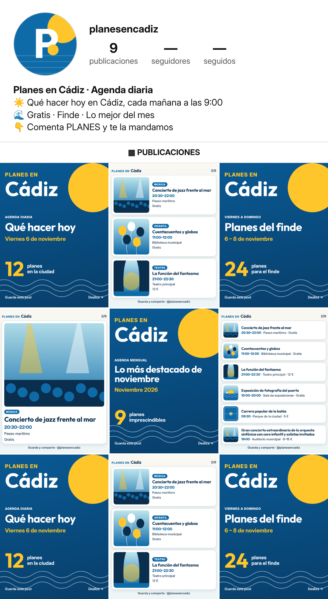

# Dirección 1 · Mediterráneo luminoso



## Sistema
- **Logo modular:** pieza fija «Planes en» + ciudad variable (se reduce sola si el nombre es largo). «PLANES EN» en versalitas azules + ciudad en Outfit Bold grande; sol amarillo y olas como decorado constante. Avatar: «P» blanca sobre mar con sol y olas.
- **Tipografías:** **Outfit** (títulos, 700) + **Inter** (texto, 400–800) (SIL OFL 1.1, uso comercial libre).
- **Tema en código:** `plantilla/temas/d1.css` (variables + decorado), aplicado con `tema: "d1"`.

## Paleta
| Uso | Hex |
|---|---|
| Cal (fondo) | `#FAF8F2` |
| Bruma marina (fondo 2) | `#EEF5F7` |
| Mar profundo (texto) | `#0A2E4D` |
| Mar (acento/enlaces) | `#0E6BA8` |
| Mar medio (datos) | `#0B5F95` |
| Mar de portada | `#0A5A94 → #083F6B` |
| Sol (relleno de acento) | `#FFC62B` |
| Texto secundario | `#3B566D` |
| Noche (story de tarde) | `#071D33` |

## Tono de voz (3 frases)
Fresco, claro y cercano, como un amigo que te cuenta qué hay hoy. Frases cortas y luminosas, sin gritar. Una sola llamada a la acción por texto.

## Por qué funciona para crecer en Instagram
En el feed compiten mil colores: el fondo claro con azul mar y amarillo sol se reconoce al instante y transmite «salgo a la calle». Es la opción más versátil: en otra ciudad basta cambiar el azul por su color sin perder el sistema. El contraste alto en cada diapositiva favorece guardar y reenviar, las señales que más empujan el alcance de una agenda.

## Bio propuesta (116/150 caracteres)
```
☀️ Qué hacer hoy en Cádiz, cada día a las 9:00
🌊 Gratis · Finde · Lo mejor del mes
👇 Comenta PLANES y te la mandamos
```
Nombre: `Planes en Cádiz · Agenda diaria` · usuario `@planesencadiz`.

## Comprobaciones (automáticas, `auditoria.json`)
- **Contraste WCAG AA:** cada texto renderizado se mide contra su fondo real: **mínimo 4.60:1** en todas las plantillas (AA exige 4,5:1).
- **Tamaños en la diapositiva de 6 eventos (lienzo 1080 px):** nombre 34 px, hora/lugar/precio 30 px, etiqueta de marca 26,6 px. Con 7+ eventos por diapositiva: nombre 31 px y datos 28 px (mínimos fijados). Las etiquetas de categoría (mayúsculas en negrita) usan 24 px.
- **Story:** todo el texto está en la zona segura (250 px libres arriba y abajo); el decorado queda fuera de ella o detrás.

## Piezas
`01-logo-modular` (Cádiz, Valladolid, Plans in Lisbon) · `01b-logo-nombres-extremos` · `02-foto-perfil-320` y `02b-…-prueba-circulo` · `03-portada-diaria` · `04-eventos-1/3/6` · `05-story-evento` · `06-story-esta-noche` · `07-sin-foto-música/infantil` · `08-destacada-hoy/finde/mes/gratis` · `09-portada-finde` · `10-portada-mensual` · `11-story-patrocinada` · `12-mosaico-perfil`. Ilustraciones de ejemplo (sin material de terceros) en `ilustraciones/`.
