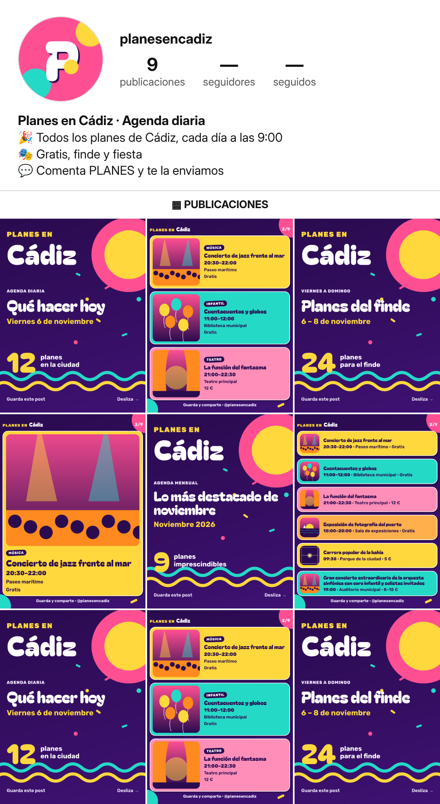

# Dirección 2 · Carnaval y alegría



## Sistema
- **Logo modular:** pieza fija «Planes en» + ciudad variable (se reduce sola si el nombre es largo). «PLANES EN» en Rubik Black amarillo + ciudad en Bagel Fat One blanca; círculos y serpentinas de decorado. Avatar: «P» redondeada blanca sobre rosa con confeti.
- **Tipografías:** **Bagel Fat One** (títulos, único peso) + **Rubik** (texto, 300–900) (SIL OFL 1.1, uso comercial libre).
- **Tema en código:** `plantilla/temas/d2.css` (variables + decorado), aplicado con `tema: "d2"`.

## Paleta
| Uso | Hex |
|---|---|
| Violeta noche (fondo) | `#2A0B4F` |
| Violeta 2 (fondo) | `#3F1273` |
| Amarillo confeti | `#FFD83D` |
| Rosa chirigota | `#FF4F93` |
| Turquesa | `#25D9C7` |
| Naranja | `#FF8A1F` |
| Rosa claro (tarjeta) | `#FF8FB8` |
| Texto sobre color | `#2A0B4F` |

## Tono de voz (3 frases)
Desenfadado, con guiño y energía, sin caricatura ni tópicos. Exclamaciones con mesura y emojis festivos (0–3). Invita a «liarla» con alguien: etiquetar y compartir.

## Por qué funciona para crecer en Instagram
Es la más memorable y la que mejor se distingue en una cuadrícula de fotos: cada tarjeta de color es una pieza «parable» al hacer scroll, y encaja con la identidad festiva de la ciudad y con fiesta, música y familias. Riesgo: más densidad visual; por eso las tarjetas llevan texto oscuro sobre fondos claros y el decorado queda fuera de las zonas de texto.

## Bio propuesta (107/150 caracteres)
```
🎉 Todos los planes de Cádiz, cada día a las 9:00
🎭 Gratis, finde y fiesta
💬 Comenta PLANES y te la enviamos
```
Nombre: `Planes en Cádiz · Agenda diaria` · usuario `@planesencadiz`.

## Comprobaciones (automáticas, `auditoria.json`)
- **Contraste WCAG AA:** cada texto renderizado se mide contra su fondo real: **mínimo 7.84:1** en todas las plantillas (AA exige 4,5:1).
- **Tamaños en la diapositiva de 6 eventos (lienzo 1080 px):** nombre 34 px, hora/lugar/precio 30 px, etiqueta de marca 26,6 px. Con 7+ eventos por diapositiva: nombre 31 px y datos 28 px (mínimos fijados). Las etiquetas de categoría (mayúsculas en negrita) usan 24 px.
- **Story:** todo el texto está en la zona segura (250 px libres arriba y abajo); el decorado queda fuera de ella o detrás.

## Piezas
`01-logo-modular` (Cádiz, Valladolid, Plans in Lisbon) · `01b-logo-nombres-extremos` · `02-foto-perfil-320` y `02b-…-prueba-circulo` · `03-portada-diaria` · `04-eventos-1/3/6` · `05-story-evento` · `06-story-esta-noche` · `07-sin-foto-música/infantil` · `08-destacada-hoy/finde/mes/gratis` · `09-portada-finde` · `10-portada-mensual` · `11-story-patrocinada` · `12-mosaico-perfil`. Ilustraciones de ejemplo (sin material de terceros) en `ilustraciones/`.
