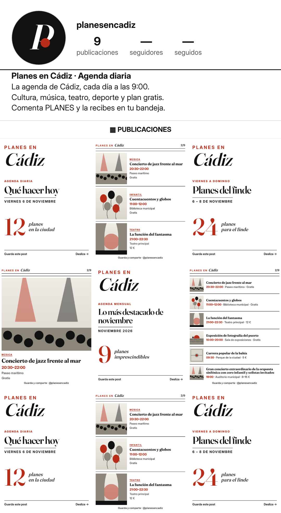

# Dirección 3 · Editorial moderno



## Sistema
- **Logo modular:** pieza fija «Planes en» + ciudad variable (se reduce sola si el nombre es largo). «PLANES EN» en Inter espaciada bermellón + ciudad en Fraunces cursiva grande. Avatar: «P» cursiva blanca sobre negro con punto bermellón.
- **Tipografías:** **Fraunces** (títulos, serif con cursiva) + **Inter** (texto) (SIL OFL 1.1, uso comercial libre).
- **Tema en código:** `plantilla/temas/d3.css` (variables + decorado), aplicado con `tema: "d3"`.

## Paleta
| Uso | Hex |
|---|---|
| Blanco (fondo) | `#FFFFFF` |
| Tinta (texto/filetes) | `#111111` |
| Gris texto secundario | `#4A4A4A` |
| Bermellón (acento) | `#B72D19` |
| Papel (ilustraciones) | `#F1EEE8` |
| Salmón (story de tarde) | `#FF7A5C` |

## Tono de voz (3 frases)
Sobrio, preciso y cultural, como el suplemento de un periódico. Frases completas y datos exactos, cero exageración. La confianza del dato sustituye a la exclamación.

## Por qué funciona para crecer en Instagram
Posiciona la cuenta como medio de referencia: atrae a público cultural, prensa, instituciones y patrocinadores serios. Mucho blanco = lectura rapidísima. Es la que mejor escala a más ciudades e idiomas porque el sistema es tipográfico y el único color es un acento. Riesgo: menos «parada de scroll» que la 2; se compensa con el número gigante en rojo de cada portada.

## Bio propuesta (131/150 caracteres)
```
La agenda de Cádiz, cada día a las 9:00.
Cultura, música, teatro, deporte y plan gratis.
Comenta PLANES y la recibes en tu bandeja.
```
Nombre: `Planes en Cádiz · Agenda diaria` · usuario `@planesencadiz`.

## Comprobaciones (automáticas, `auditoria.json`)
- **Contraste WCAG AA:** cada texto renderizado se mide contra su fondo real: **mínimo 6.17:1** en todas las plantillas (AA exige 4,5:1).
- **Tamaños en la diapositiva de 6 eventos (lienzo 1080 px):** nombre 34 px, hora/lugar/precio 30 px, etiqueta de marca 26,6 px. Con 7+ eventos por diapositiva: nombre 31 px y datos 28 px (mínimos fijados). Las etiquetas de categoría (mayúsculas en negrita) usan 24 px.
- **Story:** todo el texto está en la zona segura (250 px libres arriba y abajo); el decorado queda fuera de ella o detrás.

## Piezas
`01-logo-modular` (Cádiz, Valladolid, Plans in Lisbon) · `01b-logo-nombres-extremos` · `02-foto-perfil-320` y `02b-…-prueba-circulo` · `03-portada-diaria` · `04-eventos-1/3/6` · `05-story-evento` · `06-story-esta-noche` · `07-sin-foto-música/infantil` · `08-destacada-hoy/finde/mes/gratis` · `09-portada-finde` · `10-portada-mensual` · `11-story-patrocinada` · `12-mosaico-perfil`. Ilustraciones de ejemplo (sin material de terceros) en `ilustraciones/`.
